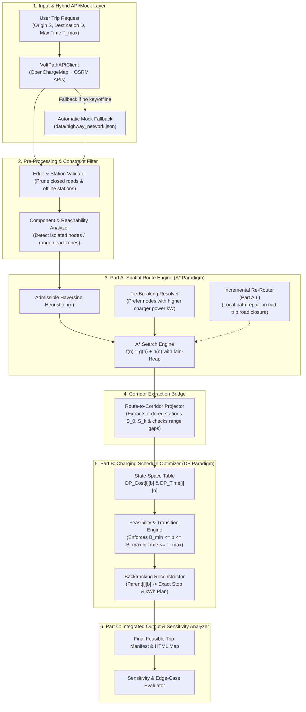

# VoltPath System Architecture (NED CT-363 DAA CEP)

## 1. High-Level Block Diagram

## 2. Layered Component Responsibilities
1. **`src/api_client.py` (Hybrid Data Layer):** Queries live OpenChargeMap & OSRM endpoints if configured, falling back automatically to curated local JSON datasets (`data/*.json`) when offline or when no API key is present.
2. **`src/preprocessor.py` (Constraint Hygiene Layer):** Removes blocked roads (`is_blocked == True`), detects disconnected components, excludes offline stations (`is_available == False`), and clamps station power to the EV's maximum acceptance rate.
3. **`src/astar_router.py` (Part A — Heuristic Paradigm):** Computes the shortest feasible highway corridor using `A*` with an admissible Haversine heuristic, charger-power tie-breaking, and localized incremental path repair.
4. **`src/corridor_bridge.py` (Corridor Projection Layer):** Maps the 2D route into a 1D station sequence and verifies that no inter-station gap exceeds maximum usable battery capacity $(B_{\max} - B_{\min})$.
5. **`src/dp_charger.py` (Part B — Dynamic Programming Paradigm):** Solves the multi-stage charging stop and energy allocation problem via state table $DP[i][b]$ and reconstructs the exact charging schedule via parent pointer backtracking.
6. **`src/pipeline.py` & `ui/dashboard.py` (Part C — Integration & Visualization):** Orchestrates end-to-end execution, sensitivity analysis, and generates the free OpenStreetMap HTML dashboard.
